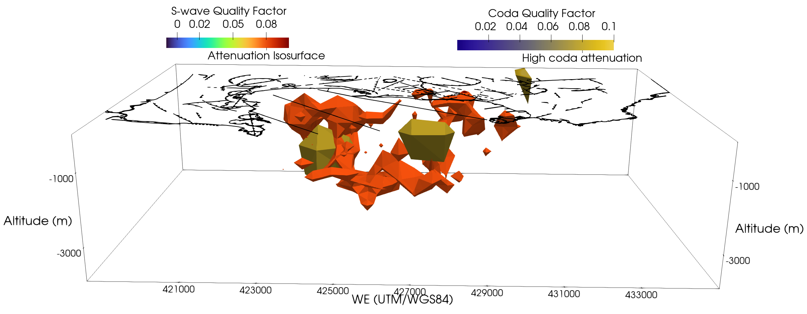
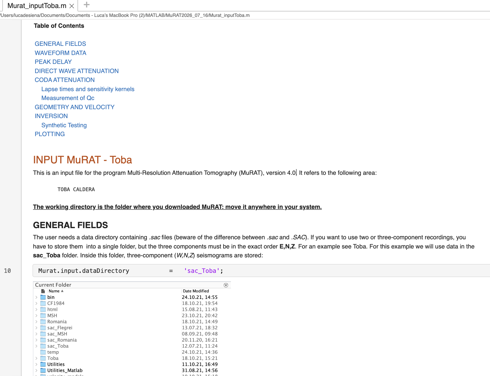
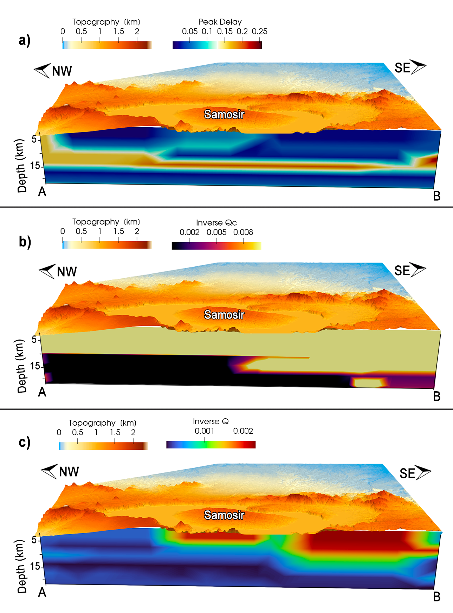

# Summary

`MuRAT4` (Multi-Resolution Seismic Attenuation Tomography, version 4.0) is an open-access, MATLAB-based framework for measuring and imaging three-dimensional spatial variations of seismic attenuation. It provides tools to separate and image three attenuation mechanisms from proxies measured on seismograms: direct-wave attenuation via the coda-normalization method, scattering attenuation via the peak-delay method, and absorption via late-time coda attenuation. Version 4.0 systematizes these capabilities into a reproducible workflow that measures and inverts the three attributes within tomographic frameworks. It is applicable to geological environments ranging from rock volumes to the lithosphere, and has demonstrated applications to seismic-hazard assessment in volcanic, tectonic, geothermal, and subduction settings.

# Statement of Need

Seismic attenuation is a fundamental parameter for understanding subsurface structures and physical processes, constraining heterogeneity, fluid and melt
content, temperature, and seismic energy loss in the Earth's interior, and contributing to seismic-hazard assessment [@mitchell95; @pozgay09; @rawlinson10; @desiena14b]. Attenuation tomography has become an essential complement to velocity imaging for characterizing complex geological environments where scattering and intrinsic absorption strongly modulate seismic amplitudes and waveforms [@desiena09a; @delpezzo16]. Despite its importance, a critical gap exists in computational seismology for accessible, standardized tools capable of both separating scattering and intrinsic absorption from single-station seismogram amplitudes and imaging attenuation and its mechanisms in a reliable tomographic framework. `MuRAT4`, distributed as the [LucaDeSiena/MuRAT](https://github.com/LucaDeSiena/MuRAT) GitHub repository, is a MATLAB-based framework that addresses this gap by measuring heterogeneous loss using different seismic attributes and modeling their spatial variations in different inversion frameworks.

# State of the Field

## Open-access codes for measuring and modelling attenuation

Attenuation tomography is established for imaging anelastic structure at global, regional, and local scales [@holiu88; @lees94; @romanowicz1998; @rawlinson10]. However, different mechanisms attenuate seismic waves while they propagate. Several open-source tools are available for estimating or imaging seismic attenuation, although they target different observables and spatial scales. *Qopen* is a Python package that separates intrinsic and scattering attenuation by inversion of seismic-wave envelopes [@eulenfeld16]. Following this research line, the *QEST* code has been developed explicitly for inverting 1-D frequency-dependent scattering and intrinsic attenuation [@vanlaaten24]. *AttenuationVoronoi* implements trans-dimensional Bayesian attenuation tomography using spherical Voronoi cells and has been applied to image attenuation in the Earth's inner core, providing ensembles of models and associated measures of spatial uncertainty [@pejic19].

These packages demonstrate the growing availability of open computational tools for seismic attenuation analysis, while addressing distinct combinations of wave type, attenuation observable, parameterization, and inversion strategy. While existing codes address individual attenuation observables or total attenuation, `MuRAT4` combines multiple seismic attributes to measure attenuation, separate its mechanisms, and model their spatial variations using seismic inversion from earthquake seismograms. *MuRAT1.0* [@desiena14a] converted several Bash, Fortran, and C++ tools to MATLAB and implemented coda-normalization tomography for imaging seismic attenuation [@delpezzo06; @desiena08; @desiena09a; @prudencio20]. *MuRAT2.0* separated seismic scattering from absorption using PD and Qc as proxies [@takahashi07; @calvet13b], and imaged them in 2D [@desiena16; @borleanu17; @napolitano20; @guardo22a]. *MuRAT3.0* extended the framework to full 3D [@desiena17a; @desiena17b; @reiss22; @napolitano25; @yemane25; @napolitano23; @gabrielli23; @talone23; @talone25; @feng26]. The models shown in Fig. 1 represent results of the application of MuRAT3.0 at Campi Flegrei caldera (Italy) [@desiena17a; @desiena17b]. This and the following 3D figures are obtained by importing the output *.txt* files representing the models into [Paraview](https://www.paraview.org/) using the [GeophysicalModelGenerator.jl](https://github.com/JuliaGeodynamics/GeophysicalModelGenerator.jl) [@kaus24].

{width=100%}

## Related software packages

`MuRAT4` is implemented in MATLAB and uses the Curve Fitting, Signal Processing, Optimization, Global Optimization, Image Processing, and Mapping Toolboxes. Parallel Computing Toolbox is optional. The framework also incorporates open-source routines for SAC file handling, regularization, and geometry and image processing.

# Software Design

`MuRAT4` implements three complementary measurements and several inversion schemes using [SAC files](https://ds.iris.edu/files/sac-manual/) that can be downloaded from online servers and must have populated headers:

* **Direct-wave attenuation:** `MuRAT4` uses the coda-normalization (CN) method to estimate direct-wave attenuation from frequency-domain direct and coda-wave energies [@aki80a; @yoshimoto93]. Originally developed for volcanic tomography [@delpezzo06; @desiena08; @desiena09a], its main advantage is in the strong reduction of source and site effects.

* **Scattering attenuation:** Peak delays (PD) quantify the time difference between the direct-wave arrival and maximum envelope amplitude and are used as markers of scattering [@saito02; @takahashi07; @takahashi09; @tripathi10; @calvet13a; @calvet13b; @desiena16; @sato16]. `MuRAT4` accounts for both conventional far-field scattering and strong-scattering effects, including trapped waves and resonances [@napolitano20; @dimartino22b; @desiena16; @gabrielli20; @king22; @king23].

* **Absorption:** `MuRAT4` estimates seismic absorption from coda attenuation (Qc) after a preliminary Multiple-Lapse-Time-Window Analysis (MLTWA) to constrain albedo and extinction lengths [@fehler88; @gabrielli20]. Diffusive modelling and differential sensitivity kernels are used for the inversion [@paasschens97; @pacheco05].

* **Inversion framework:** `MuRAT4` provides standard Tikhonov regularization and alternative iterative MATLAB optimization methods. A regularization matrix $L$ and damping parameter $\epsilon$ control the trade-off between data misfit and model smoothness.

## Example Usage
`MuRAT4` comes with built-in tests and three tutorials as commented live text files that explain the inputs necessary to perform tomography with the three methods and the rationale to select them. In the following, we present the Toba (Indonesia) test case. Two additional test cases are provided for Mount St. Helens (US) and Romania. The Toba test case is based on a dataset of 860 waveforms recorded in the Toba caldera region in 2008. The input file contains the SAC file paths. These files include all source, station and timing information in their header. The inputs are separated by measurement types, inversion, and plotting options (Fig. 2). The output comprises three-dimensional models of direct-wave attenuation, scattering attenuation, and absorption, and several test figures used to assess the results (Fig. 3).

{width=100%}

{width=100%}

# Research Impact Statement

The MuRAT software lineage has been applied across a range of geological environments and spatial scales, including volcanic and geothermal systems, tectonic regions, subduction zones, underground gas storage, and laboratory experiments. The highest recognised impact has been produced in volcanic systems. Here, high-attenuation, scattering and absorption anomalies correlate spatially with fluid and gas reservoirs or zones of magma accumulation [@prudencio15a; @prudencio15b; @desiena17a; @desiena17b; @reiss22; @guardo22a]. The relation between high-absorption anomalies and high-temperature gradients and productive geothermal wells has recently opened pathways for applications to geothermal systems [@yemane25; @napolitano25]. At crustal, continental and lithospheric scales, scattering models have also highlighted thrust systems and localized strain near fault tips [@gabrielli23; @talone23], while absorption maps image from sedimentary basins to deeper gas and fluid-saturated volumes [@borleanu23; @talone25; @feng26]. Both peak-delay and coda-attenuation methodologies have been benchmarked and validated in laboratory environments using high-frequency (50 kHz to 1 MHz) acoustic emission and active data from triaxial core experiments [@king23; @dimartino22b].

# AI Usage Disclosure

MATLAB Copilot was used during the development of MuRAT4 within MATLAB R2025b to assist with software development. No generative AI tools were used to prepare the documentation or write this manuscript. AI-assisted code was reviewed and validated by the lead author.

# Acknowledgements

This work was funded by Deutsche Forschungsgemeinschaft, Project “A combined imaging and modelling approach to understand magmatic systems across the SE Asia-Australia collision zone”, grant 449466527. The lead developer acknowledges the contribution of the original MuRAT contributors, Christine Thomas and Richard Aster.

# References
